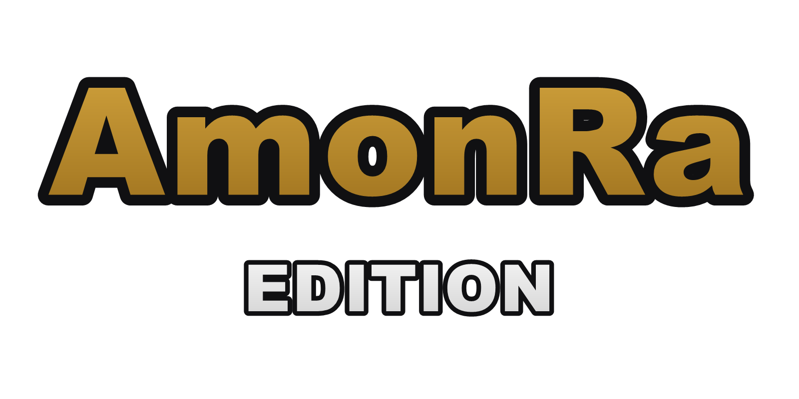

  
  <h1>Town of Us: Mira - AmonRa Edition</h1>
  
  
  

> [!NOTE]
> **English:** AmonRa Edition is a small, private fork of [Town of Us: Mira](https://github.com/AU-Avengers/TOU-Mira)
> by AU Avengers, made for playing with friends. It adds a few custom roles/modifiers and an auto-updater.
> It is **not** affiliated with or supported by the Town of Us team, so please don't report issues from this fork
> to them. If you are looking for Town of Us: Mira, go to the [original repository](https://github.com/AU-Avengers/TOU-Mira).

**AmonRa Edition** to prywatna edycja moda [Town of Us: Mira](https://github.com/AU-Avengers/TOU-Mira) do Among Us,
robiona do grania ze znajomymi. Zawiera wszystko, co ma Town of Us: Mira, plus nasze własne dodatki: modyfikatory,
role i mechaniki. Ma też automatyczne aktualizacje, więc po pierwszej instalacji nic więcej nie trzeba robić.

-----------------------

## Spis treści

- [Instalacja](#instalacja)
- [Aktualizacje](#aktualizacje)
- [Co dodaje AmonRa Edition](#co-dodaje-amonra-edition)
- [Wersje](#wersje)
- [Problemy](#problemy)
- [Dla twórców](#dla-twórców)
- [Podziękowania](#podziękowania)
- [Licencja](#licencja)

-----------------------

## Instalacja

Dla **Steam, Epic Games i Microsoft Store** (Windows, 64-bit).

1. Zaktualizuj Among Us do wersji podanej w tabeli [Wersje](#wersje).
2. Pobierz plik `TOU-Mira-ARE-...-x64-Steam-Epic.zip` z [najnowszego wydania](https://github.com/michalekjarmark/TOU-Mira-ARE/releases/latest)
   i rozpakuj go.
3. Otwórz folder z grą:
   - **Steam:** Biblioteka → prawy przycisk na „Among Us” → Zarządzaj → Przeglądaj pliki lokalne.
   - **Epic Games:** zwykle `C:\Program Files\Epic Games\AmongUs`.
4. Skopiuj **całą zawartość** rozpakowanego folderu (BepInEx, dotnet, CorsacCosmetics, `version.dll` i resztę)
   do folderu z grą. Jeśli Windows zapyta, wybierz „Zamień pliki”.
5. Uruchom grę normalnie. Pierwsze uruchomienie trwa kilka minut. W menu głównym, w lewym górnym rogu,
   powinien pojawić się napis „Town of Us: Mira - AmonRa Edition”.

Wszyscy gracze w lobby muszą mieć **tę samą wersję** moda.

## Aktualizacje

Mod aktualizuje się sam. Przy starcie gry sprawdza, czy jest nowe wydanie, pobiera je w tle i pokazuje komunikat.
Po zakończeniu pobierania wystarczy ponownie uruchomić grę. Listę zmian w każdej wersji znajdziesz w
[CHANGELOG.md](CHANGELOG.md).

Automatyczne aktualizacje można wyłączyć w pliku `BepInEx/config/auavengers.tou.mira.cfg`
(`[Updater]` → `AutoUpdate = false`).

## Co dodaje AmonRa Edition

Pełna lista ról i modyfikatorów Town of Us: Mira jest na [wiki Town of Us: Mira](https://au-avengers.github.io/docs.toum.gg/).
Poniżej tylko nasze dodatki.

| | Nazwa | Typ | Opis |
|:-:|:--|:--|:--|
|  | **AmonRa** | Modyfikator (uniwersalny) | Postać jeździ na wózku. Rozpędza się stopniowo, toczy się po puszczeniu klawiszy i ślizga na zakrętach, ale na długich prostych jest szybsza od innych. Wenty, drabiny i taski działają normalnie. |

Oprócz tego: automatyczne aktualizacje, pełna paczka instalacyjna i własne logo na ekranie startowym.

## Wersje

| Among Us | AmonRa Edition | Bazuje na Town of Us: Mira | Pobierz |
|:--|:--|:--|:--|
| 2026.9.29 | 1.7.9-are.1 (w przygotowaniu) | 1.7.9 (`dev`) | wkrótce |

## Problemy

- **Gra uruchamia się bez moda** (brak napisu w menu): w folderze gry zmień nazwę pliku `version.dll` na `winhttp.dll`.
- **Gra zamyka się przy pierwszym uruchomieniu:** sprawdź, czy w folderze gry nie ma jednocześnie `winhttp.dll`
  i `version.dll` (np. po innym modzie). Zostaw tylko `version.dll`.
- **Wyłączenie moda:** usuń (albo zmień nazwę) `version.dll` w folderze gry.
- **Odinstalowanie:** usuń foldery `BepInEx`, `dotnet`, `CorsacCosmetics` i plik `version.dll`, a potem sprawdź
  spójność plików gry w Steam/Epic.
- Błędy z tej edycji zgłaszaj nam, **nie** zespołowi Town of Us. Przy błędzie przydaje się plik
  `BepInEx/LogOutput.log` z folderu gry.

## Dla twórców

- Branch roboczy: **`are`** (oparty na `dev` z upstreamu). `main` to kopia `main` z upstreamu.
- Build: `dotnet build TownOfUs-Mira.sln -c Release` (.NET SDK 8 lub 9; pierwszy build pobiera biblioteki gry).
  Test lokalny prosto do gry:
  `dotnet build TownOfUs-Mira.sln -c Release -p:VersionSuffix=are-dev -p:BuildAllPlatforms=false "-p:AmongUs=<folder gry>"`.
- Kod specyficzny dla AmonRa Edition: `TownOfUs/Are/` (nazwa, updater, logo), nasze grafiki: `TownOfUs/Resources/Custom/`.
- Wydanie: dopisz zmiany w `CHANGELOG.md`, podbij `VersionSuffix` w `Directory.Build.props` (`are.1` → `are.2`)
  i uruchom `tools/are-release.ps1` (build, tag, GitHub Release z DLL-kami i pełną paczką; notatki z changeloga).
- Zmiany z upstreamu: `git fetch upstream && git merge upstream/dev`. Przy konflikcie w `README.md` zostaw naszą wersję.

## Podziękowania

AmonRa Edition stoi na barkach **[Town of Us: Mira](https://github.com/AU-Avengers/TOU-Mira)** od
**Among Us Avengers** (Atony, AlchlcSystm, angxlwtf, MyDragonBreath, Nix, Satire, xerminator, XtraCube, whichtwix, Zeo)
oraz wszystkich osób, które przyczyniły się do tego moda. Poniżej oryginalne podziękowania z Town of Us: Mira.

[MiraAPI](https://github.com/All-Of-Us-Mods/MiraAPI) - The primary framework of the mod\
[Zeo666](https://github.com/Zeo666) - For implementing the Game Timer mechanic.\
[le killer](https://github.com/lekillerdesgames) - For implementing the split faction chat.\
[AlchlcDvl](https://github.com/AlchlcDvl) - For implementing the Spectator feature.\
[xChipseq](https://github.com/xChipseq) - For implementing the wiki hyperlinks feature for chat.\
[Amber](https://github.com/Nix-main) - For helping on the translation system.\
[IdkImNeil](https://github.com/neilmjain) - For implementing the /rules system.\
[VoidicChaos](https://github.com/VoidicChaos) - For implementing the /kick and /ban commands.\
[DivaniNL](https://github.com/DivaniNL) - For implementing extended details for misguesses.\
[rewalo](https://github.com/rewalo) - For implementing host keybinds, improving anticheat, as well as adding Time Lord, Sentry and Parasite.\
[ItzLoonie](https://github.com/ItzLoonie) - For the original implementations of the reworked Seer, Monarch, and Spellslinger roles. Also ported Deadly Quota and Circumvent modifiers.\
[Endless Host Roles](https://github.com/Gurge44/EndlessHostRoles) - For the original Deadly Quota and Circumvent modifiers.\
[Tommy-XL](https://github.com/Tommy-XL) - For the dlekS reimplementation from [Unlock dlekS](https://github.com/Tommy-XL/Unlock-dlekS-ehT).\
[Launchpad Reloaded](https://github.com/All-Of-Us-Mods/LaunchpadReloaded) - For the original Discord Status patch.\
[D1GQ](https://github.com/D1GQ) - For the original Splash Intro patch used in [Better Among Us](https://github.com/D1GQ/BetterAmongUs).\
[Maxi0fc](https://github.com/Maxi0fc) - For the original implementation of [AutoRejoin](https://github.com/Maxi0fc/AutoRejoin) and also the Role List hover feature.

> [!NOTE]
> The following credits originate from the original TOU/TOUR repositories.

[Reactor](https://github.com/NuclearPowered/Reactor) - Dependency for the mod\
[BepInEx](https://github.com/BepInEx) - For hooking game functions\
[Among-Us-Sheriff-Mod](https://github.com/Woodi-dev/Among-Us-Sheriff-Mod) - For the Sheriff role.\
[Among-Us-Love-Couple-Mod](https://github.com/Woodi-dev/Among-Us-Love-Couple-Mod) - For the inspiration of Lovers role.\
[ExtraRolesAmongUs](https://github.com/NotHunter101/ExtraRolesAmongUs) - For the Engineer & Medic roles.\
[TooManyRolesMods](https://github.com/Hardel-DW/TooManyRolesMods) - For the Investigator & Time Lord roles.\
[TorchMod](https://github.com/tomozbot/TorchMod) - For the inspiration of the Torch modifier.\
[XtraCube](https://github.com/XtraCube) - For the Rainbow color.\
[TheOtherRoles](https://github.com/Eisbison/TheOtherRoles) - For the inspiration of the Vigilante, Sonar (formerly Tracker) and Spy roles, as well as the Bait modifier.\
[5up](https://www.twitch.tv/5uppp) and the Submarine Team - For the inspiration of the Grenadier role.\
[MyDragonBreath](https://github.com/MyDragonBreath) - For Submerged Compatibility, the Trapper and Aurial roles, and the Aftermath modifier\
[ItsTheNumberH](https://github.com/itsTheNumberH/Town-Of-H) - For the code used for Blind, Bait, Poisoner and partially for Sonar, as well as other bug fixes.\
[Ruiner](https://github.com/ruiner189/Town-Of-Us-Redux) - For lovers changed into a modifier and Task Tracking.\
[Term](https://www.twitch.tv/termboii) - For creating Transporter, Medium, Blackmailer, Plaguebearer, Sleuth, Multitasker.\
[BryBry16](https://github.com/Brybry16/BetterPolus) - For the code used for Better Polus.

-----------------------

## Licencja

This software is distributed under the GNU GPLv3 License. BepInEx is distributed under the LGPL-2.1 License.
Zobacz [LICENSE.txt](LICENSE.txt).

## Copyright

This mod is not affiliated with Among Us or Innersloth LLC, and the content contained therein is not endorsed or otherwise sponsored by Innersloth LLC. Portions of the materials contained herein are property of Innersloth LLC.

© Innersloth LLC.

