

  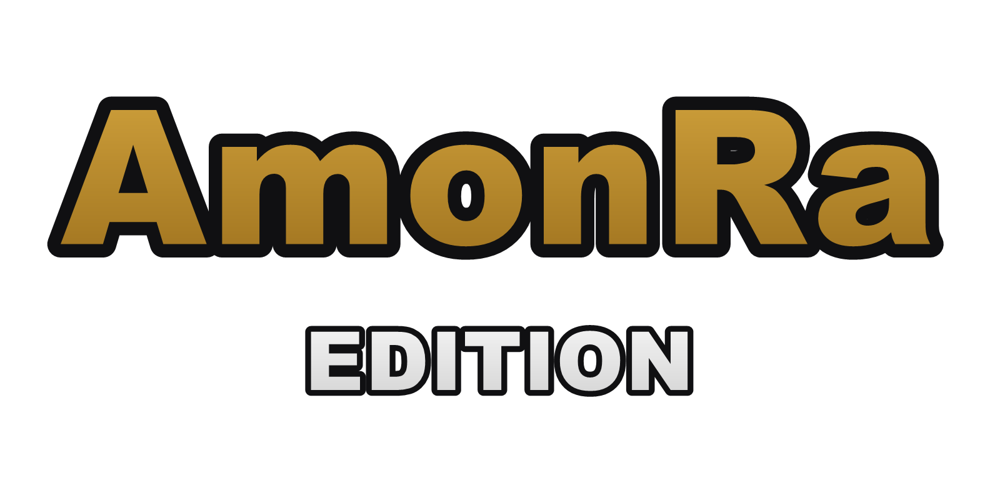
  <h1>Town of Us: Mira - AmonRa Edition</h1>
  
  
  
  
<b>English</b> | <a href="README.pl.md">Polski</a>

> [!NOTE]
> AmonRa Edition is a small, private fork of [Town of Us: Mira](https://github.com/AU-Avengers/TOU-Mira) by AU Avengers,
> made for playing with friends. It is **not** affiliated with or supported by the Town of Us team, so please don't
> report issues from this fork to them. Looking for the original mod? Go to the [original repository](https://github.com/AU-Avengers/TOU-Mira).

An [Among Us](https://store.steampowered.com/app/945360/Among_Us) mod based on Town of Salem. AmonRa Edition contains
everything from Town of Us: Mira, plus our own roles, modifiers and mechanics. It also updates itself, so after the
first installation there is nothing else to do.

-----------------------

# Contents

- [**Installation**](#installation)
- [**Updates**](#updates)
- [**AmonRa Edition additions**](#amonra-edition-additions)
- [**Releases**](#releases)
- [**Changelog**](CHANGELOG.md)
- [**Troubleshooting**](#troubleshooting)
- [**For developers**](#for-developers)
- [**Town of Us: Mira**](#town-of-us-mira): key differences, [roles and modifiers](#roles-and-modifiers), languages, mod compatibility
- [**Credits**](#contributions--credits)
- [**License**](#license)

-----------------------

# Installation

For **Steam, Epic Games and Microsoft Store** (Windows, 64-bit).

1. Update Among Us to the version listed in [Releases](#releases).
2. Download `TOU-Mira-ARE-...-x64-Steam-Epic.zip` from the [latest release](https://github.com/michalekjarmark/TOU-Mira-ARE/releases/latest)
   and extract it.
3. Open the game folder:
   - **Steam:** Library → right-click "Among Us" → Manage → Browse local files.
   - **Epic Games:** usually `C:\Program Files\Epic Games\AmongUs`.
4. Copy **everything** from the extracted folder (BepInEx, dotnet, CorsacCosmetics, `version.dll` and the rest)
   into the game folder. If Windows asks, choose "Replace the files".
5. Start the game as usual. The first start takes a few minutes. The main menu should show
   "Town of Us: Mira - AmonRa Edition" in the top left corner.

Everyone in a lobby needs **the same version** of the mod.

# Updates

The mod updates itself. On startup it checks for a new release, downloads it in the background (verifying its
SHA-256 checksum) and shows a message. When the download is done, just restart the game. What changed in each
version is in the [changelog](CHANGELOG.md).

Automatic updates can be turned off in `BepInEx/config/auavengers.tou.mira.cfg` (`[Updater]` → `AutoUpdate = false`).

# AmonRa Edition additions

Everything below is new in AmonRa Edition. For all roles and modifiers of Town of Us: Mira see
[Roles and modifiers](#roles-and-modifiers).

| Name | Type | Description |
|:-:|:--|:--|
| 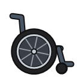 **AmonRa** | Modifier (Universal) | The player rides a wheelchair with a rolling wheel and sound. Speeds up gradually and keeps rolling after letting go. Turns quickly when slow but needs wide turns at full speed: smooth driving keeps the momentum and is faster than everyone else, sharp turns skid and lose speed. Vents, ladders and tasks work as usual. |
| 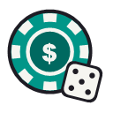 **Gambler** | Role (Neutral Evil) | In every meeting, before the votes are revealed, secretly bets on who gets ejected (or that no one is). Correct bets give a point, wrong ones take one away. Collecting enough points while alive wins the game. Optionally everyone is warned (or the Gambler is revealed) when they are close to winning. |
|  **Auditor** | Role (Crewmate Investigative) | Secretly audits a nearby player for a while: the report in the next meeting shows tasks completed, task stations where they stood without progress and a single count of irregularities (vents, kills, role abilities, crewmate abilities included). Gets more audits by doing tasks. Once per game can publish a report to everyone, revealing themselves. Optionally the target is told it is audited, and the Auditor can freeze one vote. |
| 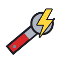 **Rigger** | Role (Impostor Support) | Rigs real task stations (up to 2 at once). When a crewmate keeps a rigged task open for a moment without finishing it, the trap fires: the impostors get an alert and an arrow to the station, and the task jams and closes. Finishing the task sooner sets nothing off. Rigged stations spark up close, so careful crewmates can notice them. Rigs are cleared at every meeting. Optionally (off by default) the trap also kills the crewmate it fires on. |
|  **Insider** | Role (Impostor Concealing) | An impostor who can really do the tasks from their list, so everyone (and the Auditor) sees real work. Every completed task permanently lowers their kill cooldown a little (1 s by default, down to a minimum). By default their tasks also count as crew progress, so a faster kill also brings the crew closer to a task win. |
| 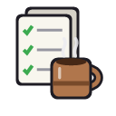 **Workaholic** | Role (Crewmate Support) | After finishing their own tasks, takes over tasks of other crewmates, one at a time: always an unstarted task of the crewmate with the most tasks left (dead ones too, if ghosts do tasks), never the Snitch's. The crewmate sees that someone took over their task and can't do it; once the Workaholic finishes it, it counts as the crewmate's task. If the Workaholic dies, the task goes back. Options: cooldown, a limit of taken tasks, whether the crewmate sees the helper's name. |
|  **Ventriloquist** | Role (Impostor Support) | Eavesdrops on a nearby player during the round (an interaction). At the next meeting, writes in the chat with that player's voice: everyone sees a normal message from that player, with their name, color and look. The player sees the message as their own and can deny it, but doesn't learn who wrote it. With the vote steal option (by default instead of writing) the Ventriloquist can also redirect that player's vote: it goes where the Ventriloquist chose. The voice works for one meeting only and can't be used while its owner is dead, blackmailed or jailed without the public chat. Options: eavesdrop cooldown, eavesdrops per game, messages per meeting (1 by default), vote steal (off / instead of chat / with chat). |
| 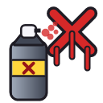 **Vandal** | Role (Impostor Support) | At a task station, breaks a task that someone has already finished: the task goes back to its owner as not done, from the first step, and the task bar drops. By default one use breaks the task of one random player who finished it, with the option everyone's. The owner gets a message and has to do the task again (a Workaholic can take it over). Only tasks of living players that count toward the task bar, never the Snitch's or tasks that use up objects on the map. The Auditor counts every use. Options: cooldown, breaks per game, whose task one use breaks, what the owner is told (with the task's name / without it / nothing). |
| 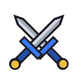 **Rivals** | Modifier (Alliance) | The opposite of the Lovers: two players know each other as rivals (a ≠ after the name, no role). Each of them wins only if the other one doesn't survive until the end of the game, on top of the normal win of their team (or their own role): with the rival alive at the end they lose even when their team wins. No message when the rival dies. Options: chance, chance that one of them is a killer, both can be killers, neutral roles can be rivals (crewmates only = 0% and no neutral roles). |
| 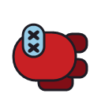 **Possum** | Role (Impostor Killing) | Plays dead: the Possum disappears and their own body lies in their place. Reporting that body doesn't start a meeting: the Possum gets up and the reporter is stunned for a few seconds (can't move or use anything), a chance for a kill if the Possum's kill is ready. The Possum gets up with the button, or on their own when the time runs out or a meeting starts. Other body abilities (Janitor, Undertaker, Amnesiac...) don't see the fake body. Options: cooldown, max time playing dead, uses per game, stun duration. |
| 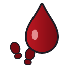 **Bleeder** | Modifier (Crewmate) | After the Bleeder dies, their killer leaves bloody footprints for a while. Everyone sees them, without the killer's color. Indirect kills leave no trail, a meeting wipes it. Options: trail time, footprint time, venting ends the trail, the killer is told. |
|  **Colorblind** | Modifier (Universal) | To the Colorblind, players further than a few steps away look camouflaged (grey, no name and by default no cosmetics); up close they look normal. Only their own view changes, meetings look normal. Options: recognition range, also hide cosmetics. |
| 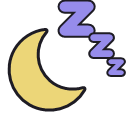 **Sleepwalker** | Modifier (Universal) | After standing still for a while (20 s by default), the Sleepwalker starts walking on their own, slower, in a random direction that changes now and then and at walls. Any movement wakes them up. Doing a task, a vent or a meeting doesn't count as standing. Options: time standing still, sleepwalking speed, sleepwalking time. |
| 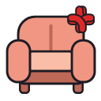 **Comfy** | Role (Crewmate Support) | Gets annoyed when a task doesn't go their way. Closing one of their own tasks before doing anything in it locks that task for them for a while and, if their sulk is ready, starts it: for a few seconds kills and abilities on the Comfy fail (like on the Cleric's barrier), but they can't do tasks or report bodies. While a task is locked, the Comfy can offload it to a player nearby (an interaction, 2 per game by default) and sees whether they did it. A task that isn't done comes back at the start of the next meeting, and an impostor can't do it, so offloading is also a test. Every number and rule is a lobby option: lock time, sulk time and cooldown, what the sulk stops and blocks, offloads per game and cooldown, whether the task comes back, whether the receiver sees the name. |
|  **Lighthouse Keeper** | Role (Crewmate Support) | Places lanterns on the map (3 per game by default), visible to everyone. During a lights sabotage, every player within a lantern's radius sees as if the lights were on, like with the Torch. Lanterns stay until the end of the game. Options: cooldown, lanterns per game, light radius, walls block the light, everyone sees the lanterns, lanterns go out when the Keeper dies. |
| 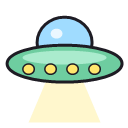 **Expert** | Role (Crewmate Investigative) | Examines a nearby player and learns their exact role, shown on their name. With a chance (30% by default) the result is made up, a different role, and the Expert never knows which results are wrong. By default each player can be examined only once. Options: cooldown, examinations per game, chance of a wrong result and its growth with every examination, what a wrong result shows (a role in this game / any role / a role of another faction), examining the same player again. |
| 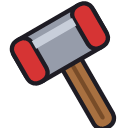 **Moderator** | Role (Impostor Support) | Bans a nearby player from one thing until the next meeting (or for a set time): reporting bodies, the meeting button, tasks, getting into vents, cams/admin/vitals (also portable), abilities (kill and sabotage included) or the vote in the next meeting (it doesn't count). The type is drawn at random from the enabled ones, or (option) chosen with a second button. Sabotage repairs, doors and ladders are never blocked. The Cleric's Cleanse removes bans. Options: cooldown, bans per game and per round, ban length, each ban type on/off, the Moderator chooses the type, the banned player gets a message. |
|  **Chairman** | Role (Crewmate Support) | Orders a nearby player to finish any task within a short time (30 s by default). A done order finishes one of the Chairman's own tasks and the player's vote counts twice in the next meeting; a missed one means the player's vote doesn't count. Impostors can't do tasks, so an order is also a test. Done orders bring promotions: Director (a meeting from anywhere once per game), Chairman (sees who voted for whom), King (double vote). Options: cooldown, time, orders per game, free task, bonus, reprimand, the player sees the name, public promotions, each title and its threshold. |
|  **Handyman** | Role (Crewmate Support) | Gets a random job at the start of every round, with an ability for that round (one use by default): PC Service (fix a sabotage from anywhere), Pizzeria (a sprint), Warehouse (admin from anywhere) or Stream (cameras from anywhere; never on maps without cameras). Options: uses per round, cooldown, the same job twice in a row, each job on/off with its time (fix delay, sprint time and speed, admin time and moving with it, cameras time). |
| 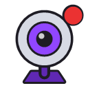 **Streamer** | Modifier (Universal) | Sees "LIVE: N viewers" whenever someone watches a camera feed with them in it (map cameras, Sentry cameras, the portable ones of the Operative and the Handyman, a Stream Sniper's view; the admin map as an option), without names. "Go offline" hides them from the cameras for a few seconds. Options: admin map counts, show the number of viewers, the "Go offline" button, its time and uses per round. |
|  **Stream Sniper** | Role (Impostor Support) | Watches the view around a chosen living player for a few seconds (8 s by default) in a small window in a corner of the screen, through walls and darkness. Moves normally meanwhile. A watched Streamer gets a viewer. Options: cooldown, time, watches per game, view size, who can be watched (anyone from a list / only the player marked earlier next to them), mark cooldown, a meeting clears the mark, the watched player knows. |
| 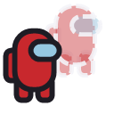 **Fabulist** | Role (Impostor Concealing) | Leaves a copy of themselves at a task console as an alibi (20 s by default), seen by everyone, cameras included, while the real Fabulist walks away. The copy disappears when another player comes close, at a meeting or when the Fabulist dies, and can't be killed or reported. The admin map shows the real Fabulist. Options: cooldown, time, alibis per game, the distance that breaks it, only at a task console, the admin map counts the copy. |
| 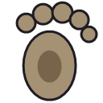 **Cryptid** | Role (Crewmate Afterlife) | A crewmate who died may become the Cryptid right away. "Appear" shows the ghost to the living for a few seconds as a blurry grey figure without a name (cameras too). It vanishes when a living player comes close; an impostor scares it off for good (option). This is how a ghost points at a body, a killer or a room without talking. Options: cooldown, time, sightings per game, the distance that makes it vanish, an impostor scares it off. |
| 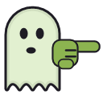 **Blame Shifter** | Role (Neutral Afterlife) | A dead neutral may become it after a meeting. The ghost blames a living player for its death (not its killer) and, a few times per game, possesses them when close: for a few seconds the player walks after the ghost and can't do anything else (they see a flash, option). Wins when the blamed player is voted out (option: collects enough votes), with the winners (option: ends the game). Options: cooldown, time, possessions per game, range, the player is notified, win mode, votes needed, the win ends the game. |
|  **Donosiciel** (Informant) | Role (Crewmate Support) | Helps others, but learns nothing. One button with two modes: "Mark" a nearby player (their colour, red or green by the Seer's rules, is taken right then), then "Show" it to another nearby player (anyone, impostors and neutrals too, but not the marked player). Only the told player sees the colour on the marked player's name, from the next meeting on until the end of the game, and doesn't know who told them. Marking is free and the mark can't be changed before it is shown; showing uses one of 3 uses and clears the mark. Both are interactions (Veteran, shields). Options: mark and show cooldowns, number of shows, usable in the first round, the Seer's colour switches (a separate copy). |

Also: a "Settings" button in Freeplay (change the lobby settings without leaving practice), a search box (with an
"AmonRa" toggle that shows only the AmonRa-themed roles and modifiers) and modifier icons in the lobby settings, automatic updates, a full installation package and our own logo on the startup
screen and in the main menu.

# Releases

| Among Us | AmonRa Edition | Based on Town of Us: Mira | Download |
|:--|:--|:--|:--|
| 2026.9.29 | 1.7.9-are.8 | 1.7.9 (`dev`) | [Download](https://github.com/michalekjarmark/TOU-Mira-ARE/releases/tag/v1.7.9-are.8) |
| 2026.9.29 | 1.7.9-are.7 | 1.7.9 (`dev`) | [Download](https://github.com/michalekjarmark/TOU-Mira-ARE/releases/tag/v1.7.9-are.7) |
| 2026.9.29 | 1.7.9-are.6 | 1.7.9 (`dev`) | [Download](https://github.com/michalekjarmark/TOU-Mira-ARE/releases/tag/v1.7.9-are.6) |
| 2026.9.29 | 1.7.9-are.5 | 1.7.9 (`dev`) | [Download](https://github.com/michalekjarmark/TOU-Mira-ARE/releases/tag/v1.7.9-are.5) |
| 2026.9.29 | 1.7.9-are.4 | 1.7.9 (`dev`) | [Download](https://github.com/michalekjarmark/TOU-Mira-ARE/releases/tag/v1.7.9-are.4) |
| 2026.9.29 | 1.7.9-are.3 | 1.7.9 (`dev`) | [Download](https://github.com/michalekjarmark/TOU-Mira-ARE/releases/tag/v1.7.9-are.3) |
| 2026.9.29 | 1.7.9-are.2 | 1.7.9 (`dev`) | [Download](https://github.com/michalekjarmark/TOU-Mira-ARE/releases/tag/v1.7.9-are.2) |
| 2026.9.29 | 1.7.9-are.1 | 1.7.9 (`dev`) | [Download](https://github.com/michalekjarmark/TOU-Mira-ARE/releases/tag/v1.7.9-are.1) |

# Troubleshooting

- **The game starts without the mod** (no mod name in the main menu): in the game folder rename `version.dll` to `winhttp.dll`.
- **The game closes on the first start:** make sure the game folder doesn't contain both `winhttp.dll` and `version.dll`
  (e.g. left over from another mod). Keep only `version.dll`.
- **Disable the mod:** delete (or rename) `version.dll` in the game folder.
- **Uninstall:** delete the `BepInEx`, `dotnet` and `CorsacCosmetics` folders and `version.dll`, then verify the game
  files in Steam/Epic.
- Report problems with this edition to us, **not** to the Town of Us team. `BepInEx/LogOutput.log` from the game
  folder helps a lot.

# For developers

- Working branch: **`are`** (based on upstream `dev`). `main` mirrors upstream `main`.
- Build: `dotnet build TownOfUs-Mira.sln -c Release` (.NET SDK 8 or 9; the first build downloads the game libraries).
  Local test straight into a game folder:
  `dotnet build TownOfUs-Mira.sln -c Release -p:VersionSuffix=are-dev -p:BuildAllPlatforms=false "-p:AmongUs=<game folder>"`.
- AmonRa Edition specific code: `TownOfUs/Are/` (name, updater, logo); our art: `TownOfUs/Resources/Custom/`.
- Known pitfalls (IL2CPP, Reactor RPC, MiraAPI, game internals, tooling): [`CAVEATS.md`](CAVEATS.md). Read it before
  writing code and add new ones there.
- Release: add the changes to `CHANGELOG.md`, bump `VersionSuffix` in `Directory.Build.props` (`are.1` → `are.2`)
  and run `tools/are-release.ps1` (build, tag, GitHub release with the DLLs and the full package; notes from the changelog).
- Upstream changes: `git fetch upstream && git merge upstream/dev`. On a conflict in `README.md` keep ours.

-----------------------

# Town of Us: Mira

The sections below come from the [Town of Us: Mira README](https://github.com/AU-Avengers/TOU-Mira#readme).
More about the mod: [Town of Us: Mira wiki](https://au-avengers.github.io/docs.toum.gg/),
[upstream changelogs](https://au-avengers.github.io/docs.toum.gg/blog), [Discord](https://discord.gg/ugyc4EVUYZ)
(for the original mod only).

## Key Differences with TOU Mira

- Revamped visuals
- New roles such as Ambassador, Ambusher, Inquisitor, Mirrorcaster
- New modifiers such as Circumvent, Scout, Telepath, Operative
- Localization to numerous languages (being worked on still)
- Vanilla role support (allowing players to use vanilla roles alongside modded roles)
- Balance changes into the mix for players to use
- Compatibility with a handful of other role mods that run on MiraAPI.

## Roles and modifiers

Click an icon to open its page on the Town of Us: Mira wiki. Our additions link to
[their description](#amonra-edition-additions) instead: **AmonRa** (wheelchair, universal modifiers), **Gambler** (chip,
Neutral Evil), **Auditor** (clipboard, Crewmate Investigative), **Rigger** (wrench, Impostor Support), **Insider** (plug,
Impostor Concealing), **Workaholic** (coffee mug, Crewmate Support), **Ventriloquist** (speech bubble on strings,
Impostor Support), **Vandal** (spray can, Impostor Support), **Rivals** (crossed swords, alliance modifiers),
**Possum** (crewmate lying down, Impostor Killing), **Bleeder** (blood drop, crewmate modifiers), **Colorblind** (eye)
and **Sleepwalker** (moon, both universal modifiers), **Comfy** (armchair) and **Lighthouse Keeper** (lantern, both
Crewmate Support), **Expert** (flying saucer, Crewmate Investigative), **Moderator** (ban hammer, Impostor
Support), **Chairman** (necktie, Crewmate Support), **Handyman** (toolbox, Crewmate Support), **Streamer** (webcam,
universal modifiers), **Stream Sniper** (screen with a crosshair, Impostor Support), **Fabulist** (crewmate
with its see-through copy, Impostor Concealing), **Cryptid** (big footprint, Crewmate Afterlife), **Blame Shifter**
(ghost pointing a finger, Neutral Afterlife) and **Donosiciel** (Informant, speech bubble with a red and a green dot, Crewmate Support).

  
  
  
  
  
  
  
  
  
  
  
  
  
  
  
  
  
  
  
  
  
  
  
  
  
  
  
  
  
  
  
  
  
  
  
  
  
  
  
  
  
  
  
  
  
  
  
  
  
  
  
  
  
  
  
  
  
  
  
  
  
  
  
  
  
  
  
  
  
  
  
  
  
  
  
  
  
  
  
  
  
  
  
  
  
  

  
  
  
  
  
  
  
  
  
  
  
  
  
  
  
  
  
  
  
  
  
  
  
  
  

  
  
  
  
  
  
  
  
  
  
  
  
  
  
  
  
  
  
  
  
  
  
  
  
  
  
  
  
  
  
  
  
  
  
  
  
  
  
  
  
  
  
  
  
  
  
  
  
  
  

## Actively Supported Languages

All languages are added via our [Weblate](https://weblate.duikbo.at/projects/town-of-us-mira/) instance. If you want to contribute to the project please let us know in the discord server!

|       Language        |                                                                                Overall Progress                                                                                 |
|:---------------------:|:-------------------------------------------------------------------------------------------------------------------------------------------------------------------------------:|
|     All Languages     |            |
|  Simplified Chinese   |  |
|  Traditional Chinese  |  |
|         Dutch         |       |
|       Filipino        |   |
|        French         |       |
|        German         |       |
|         Irish         |       |
|        Italian        |       |
|       Japanese        |       |
|        Korean         |       |
|      Lithuanian       |       |
|        Polish         |       |
|  Portuguese (Brazil)  |    |
| Portuguese (Portugal) |    |
|        Russian        |       |
|        Spanish        |       |
|    Spanish (LATAM)    |   |
|        Swedish        |       |
|        Turkish        |       |

## Mod Compatibility

> [!NOTE]
> If you wish to make an Extension Mod that builds on top of TOU Mira, you may look at [MiraAPI](https://github.com/All-Of-Us-Mods/MiraAPI)'s Example Mod or the official [Example Mod](https://github.com/AU-Avengers/TouExtensionExample).

**Disclaimer: This mod compatibility list can and will change over time.**

If a mod is missing here and is a role/modifiers mod, it likely won't work unless it is built with [MiraAPI](https://github.com/All-Of-Us-Mods/MiraAPI)!

|                                    Mod                                    | Support | Notes                                                                            |
|:-------------------------------------------------------------------------:|:-------:|:---------------------------------------------------------------------------------|
|         [Localize Us!](https://github.com/AU-Avengers/LocalizeUs)         |    ✅    | TOU Mira only has a few extra translations for this.                             |
|        [Submerged](https://github.com/SubmergedAmongUs/Submerged)         |    ✅    |                                                                                  |
|       [Level Impostor](https://github.com/DigiWorm0/LevelImposter)        |    ✅    | Custom Door Types cannot be changed.                                             |
|             [NewMod](https://github.com/CallOfCreator/NewMod)             |    ✅    | Runs fine, but NewMod role icons are missing. Wiki is not fully implemented. |
| [Launchpad Reloaded](https://github.com/All-Of-Us-Mods/LaunchpadReloaded) |   ⚠️    | Wiki is not fully implemented.                                                   |

The mods below have **not** been completed/ported just yet, but will work with TOU Mira in mind.

|                                       Mod                                        |     Mod Type      | Description                                                                                      |
|:--------------------------------------------------------------------------------:|:-----------------:|:-------------------------------------------------------------------------------------------------|
| [Town of Us Edited: Mira](https://github.com/lekillerdesgames/Town-Of-Us-Edited) | Roles / Modifiers | The TOU-Edited mod, but improved and ported to Mira, adding new roles, modifiers, and mechanics! |
|            [Localize Us!](https://github.com/AU-Avengers/LocalizeUs)             |   Miscellaneous   | A mod that adds extra languages to the game, such as Polish, Swedish, and Turkish!               |

The mods below are designed to fully work with TOU Mira, often adding new roles and modifiers or extra functionality!

|                             Extension Mod                              |     Mod Type      | Description                                                                                                                                                                           |
|:----------------------------------------------------------------------:|:-----------------:|:--------------------------------------------------------------------------------------------------------------------------------------------------------------------------------------|
|        [Chaos Tokens](https://github.com/xChipseq/ChaosTokens)         |   Game Feature    | A mod that adds gambling to TOU! Each round, players can get one, two, or no tokens, which enhances the chaos in the game. Each roll may give a positive, negative, or benign effect. |
|         [Game Tweaks](https://github.com/xChipseq/GameTweaks)          |   Game Feature    | A mod that adds new gimmicks to your TOU games, ranging from gameplay changes to absolute insanity. Yes, they can be randomized too.                                                  |
| [Divani Mods](https://github.com/DivaniNL/TownOfUsMiraDivaniModsAddOn) | Roles / Modifiers | A mod that adds new roles and modifiers.                                                                                                                                              |
|   [Mira Unleashed](https://github.com/rewalo/TownOfUsMiraUnleashed)    | Roles / Modifiers | A mod that adds new roles and modifiers, primarily from Stellar Roles.                                                                                                                |
|        [Town of Extra](https://github.com/Mehzxzz/TownOfExtra)         | Roles / Modifiers | A mod that adds new roles and modifiers.                                                                                                                                              |
|        [Perfect Comms](https://github.com/artriy/Perfect-Comms)        |   Miscellaneous   | A mod that adds a built-in voice chat system to Among Us, with special support for TOU roles.                                                                                         |
|        [Mira-NotePad](https://github.com/Maxi0fc/Mira-NotePad)         |   Miscellaneous   | A client-side mod that adds a notepad that can be used in-game at any time.                                                                                                           |
|          [NameFilter](https://github.com/Maxi0fc/NameFliter)           |   Miscellaneous   | A host-side mod that filter out slurs, offensive terms, and more from player names.                                                                                                   |
|      [Mira Randomizer](https://github.com/VoidicChaos/Randomiser)      |   Miscellaneous   | A host-side mod that allows full randomization of the current preset!                                                                                                                 |

-----------------------

# Contributions & Credits

AmonRa Edition stands on the shoulders of **[Town of Us: Mira](https://github.com/AU-Avengers/TOU-Mira)** by
**Among Us Avengers** (Atony, AlchlcSystm, angxlwtf, MyDragonBreath, Nix, Satire, xerminator, XtraCube, whichtwix, Zeo)
and everyone who contributed to it. The original credits of Town of Us: Mira follow.

[MiraAPI](https://github.com/All-Of-Us-Mods/MiraAPI) - The primary framework of the mod\
[Zeo666](https://github.com/Zeo666) - For implementing the Game Timer mechanic.\
[le killer](https://github.com/lekillerdesgames) - For implementing the split faction chat.\
[AlchlcDvl](https://github.com/AlchlcDvl) - For implementing the Spectator feature.\
[xChipseq](https://github.com/xChipseq) - For implementing the wiki hyperlinks feature for chat.\
[Amber](https://github.com/Nix-main) - For helping on the translation system.\
[IdkImNeil](https://github.com/neilmjain) - For implementing the /rules system.\
[VoidicChaos](https://github.com/VoidicChaos) - For implementing the /kick and /ban commands.\
[DivaniNL](https://github.com/DivaniNL) - For implementing extended details for misguesses.\
[rewalo](https://github.com/rewalo) - For implementing host keybinds, improving anticheat, as well as adding Time Lord, Sentry and Parasite.\
[ItzLoonie](https://github.com/ItzLoonie) - For the original implementations of the reworked Seer, Monarch, and Spellslinger roles. Also ported Deadly Quota and Circumvent modifiers.\
[Endless Host Roles](https://github.com/Gurge44/EndlessHostRoles) - For the original Deadly Quota and Circumvent modifiers.\
[Tommy-XL](https://github.com/Tommy-XL) - For the dlekS reimplementation from [Unlock dlekS](https://github.com/Tommy-XL/Unlock-dlekS-ehT).\
[Launchpad Reloaded](https://github.com/All-Of-Us-Mods/LaunchpadReloaded) - For the original Discord Status patch.\
[D1GQ](https://github.com/D1GQ) - For the original Splash Intro patch used in [Better Among Us](https://github.com/D1GQ/BetterAmongUs).\
[Maxi0fc](https://github.com/Maxi0fc) - For the original implementation of [AutoRejoin](https://github.com/Maxi0fc/AutoRejoin) and also the Role List hover feature.

> [!NOTE]
> The following credits originate from the original TOU/TOUR repositories.

[Reactor](https://github.com/NuclearPowered/Reactor) - Dependency for the mod\
[BepInEx](https://github.com/BepInEx) - For hooking game functions\
[Among-Us-Sheriff-Mod](https://github.com/Woodi-dev/Among-Us-Sheriff-Mod) - For the Sheriff role.\
[Among-Us-Love-Couple-Mod](https://github.com/Woodi-dev/Among-Us-Love-Couple-Mod) - For the inspiration of Lovers role.\
[ExtraRolesAmongUs](https://github.com/NotHunter101/ExtraRolesAmongUs) - For the Engineer & Medic roles.\
[TooManyRolesMods](https://github.com/Hardel-DW/TooManyRolesMods) - For the Investigator & Time Lord roles.\
[TorchMod](https://github.com/tomozbot/TorchMod) - For the inspiration of the Torch modifier.\
[XtraCube](https://github.com/XtraCube) - For the Rainbow color.\
[TheOtherRoles](https://github.com/Eisbison/TheOtherRoles) - For the inspiration of the Vigilante, Sonar (formerly Tracker) and Spy roles, as well as the Bait modifier.\
[5up](https://www.twitch.tv/5uppp) and the Submarine Team - For the inspiration of the Grenadier role.\
[MyDragonBreath](https://github.com/MyDragonBreath) - For Submerged Compatibility, the Trapper and Aurial roles, and the Aftermath modifier\
[ItsTheNumberH](https://github.com/itsTheNumberH/Town-Of-H) - For the code used for Blind, Bait, Poisoner and partially for Sonar, as well as other bug fixes.\
[Ruiner](https://github.com/ruiner189/Town-Of-Us-Redux) - For lovers changed into a modifier and Task Tracking.\
[Term](https://www.twitch.tv/termboii) - For creating Transporter, Medium, Blackmailer, Plaguebearer, Sleuth, Multitasker.\
[BryBry16](https://github.com/Brybry16/BetterPolus) - For the code used for Better Polus.

-----------------------

# License
This software is distributed under the GNU GPLv3 License. BepInEx is distributed under the LGPL-2.1 License.

# Copyright

This mod is not affiliated with Among Us or Innersloth LLC, and the content contained therein is not endorsed or otherwise sponsored by Innersloth LLC. Portions of the materials contained herein are property of Innersloth LLC.

© Innersloth LLC.

