

  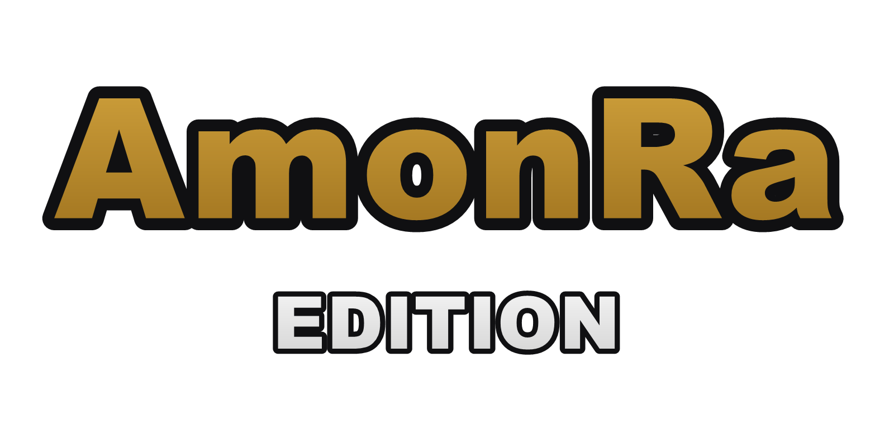
  <h1>Town of Us: Mira - AmonRa Edition</h1>
  
  
  
  
<a href="README.md">English</a> | <b>Polski</b>

> [!NOTE]
> To tłumaczenie [README.md](README.md). W razie różnic obowiązuje wersja angielska.

> [!NOTE]
> AmonRa Edition to mała, prywatna edycja moda [Town of Us: Mira](https://github.com/AU-Avengers/TOU-Mira) od AU Avengers,
> robiona do grania ze znajomymi. **Nie** jest powiązana z zespołem Town of Us ani przez niego wspierana, więc błędów
> z tej edycji nie zgłaszaj im. Szukasz oryginalnego moda? Zajrzyj do [oryginalnego repozytorium](https://github.com/AU-Avengers/TOU-Mira).

Mod do [Among Us](https://store.steampowered.com/app/945360/Among_Us) oparty na Town of Salem. AmonRa Edition zawiera
wszystko, co ma Town of Us: Mira, plus nasze własne role, modyfikatory i mechaniki. Aktualizuje się sam, więc po
pierwszej instalacji nic więcej nie trzeba robić.

-----------------------

# Spis treści

- [**Instalacja**](#instalacja)
- [**Aktualizacje**](#aktualizacje)
- [**Dodatki AmonRa Edition**](#dodatki-amonra-edition)
- [**Wersje**](#wersje)
- [**Lista zmian**](CHANGELOG.md)
- [**Problemy**](#problemy)
- [**Dla twórców**](#dla-twórców)
- [**Role i modyfikatory**](#role-i-modyfikatory)
- [**Podziękowania i licencja**](#podziękowania)

-----------------------

# Instalacja

Dla **Steam, Epic Games i Microsoft Store** (Windows, 64-bit).

1. Zaktualizuj Among Us do wersji podanej w tabeli [Wersje](#wersje).
2. Pobierz plik `TOU-Mira-ARE-...-x64-Steam-Epic.zip` z [najnowszego wydania](https://github.com/michalekjarmark/TOU-Mira-ARE/releases/latest)
   i rozpakuj go.
3. Otwórz folder z grą:
   - **Steam:** Biblioteka → prawy przycisk na „Among Us” → Zarządzaj → Przeglądaj pliki lokalne.
   - **Epic Games:** zwykle `C:\Program Files\Epic Games\AmongUs`.
4. Skopiuj **całą zawartość** rozpakowanego folderu (BepInEx, dotnet, CorsacCosmetics, `version.dll` i resztę)
   do folderu z grą. Jeśli Windows zapyta, wybierz „Zamień pliki”.
5. Uruchom grę normalnie. Pierwsze uruchomienie trwa kilka minut. W menu głównym, w lewym górnym rogu,
   powinien pojawić się napis „Town of Us: Mira - AmonRa Edition”.

Wszyscy gracze w lobby muszą mieć **tę samą wersję** moda.

# Aktualizacje

Mod aktualizuje się sam. Przy starcie gry sprawdza, czy jest nowe wydanie, pobiera je w tle (sprawdzając sumę
kontrolną SHA-256) i pokazuje komunikat. Po zakończeniu pobierania wystarczy ponownie uruchomić grę. Co się zmieniło
w każdej wersji, opisuje [lista zmian](CHANGELOG.md) (z polskim tłumaczeniem przy każdej wersji).

Automatyczne aktualizacje można wyłączyć w pliku `BepInEx/config/auavengers.tou.mira.cfg`
(`[Updater]` → `AutoUpdate = false`).

# Dodatki AmonRa Edition

Wszystko poniżej jest nowe w AmonRa Edition. Wszystkie role i modyfikatory Town of Us: Mira są w sekcji
[Role i modyfikatory](#role-i-modyfikatory).

| Nazwa | Typ | Opis |
|:-:|:--|:--|
| 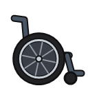 **AmonRa** | Modyfikator (uniwersalny) | Postać jeździ na wózku z obracającym się kołem i dźwiękiem toczenia. Rozpędza się stopniowo i toczy się po puszczeniu klawiszy. Wolno jadąc, skręca szybko, ale przy pełnej prędkości potrzebuje szerokich łuków: płynna jazda zachowuje rozpęd i jest szybsza od innych, a ostre skręty dają poślizg i utratę prędkości. Wenty, drabiny i taski działają normalnie. |
| 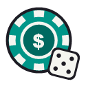 **Hazardzista** (Gambler) | Rola (Neutral Evil) | Na każdym spotkaniu, zanim głosy zostaną ujawnione, potajemnie obstawia, kto zostanie wyrzucony (albo że nikt). Trafny zakład daje punkt, chybiony go zabiera. Zebranie wystarczającej liczby punktów za życia oznacza wygraną. Opcjonalnie wszyscy dostają ostrzeżenie (albo Hazardzista zostaje ujawniony), gdy jest blisko wygranej. |
|  **Audytor** (Auditor) | Rola (Crewmate Investigative) | Potajemnie audytuje pobliskiego gracza przez jakiś czas: raport na najbliższym spotkaniu pokazuje ukończone zadania, stanowiska, przy których cel stał bez postępu, i jedną zbiorczą liczbę nieprawidłowości (wenty, zabójstwa, zdolności ról, także załogantów). Kolejne audyty zdobywa, robiąc zadania. Raz na grę może pokazać raport wszystkim, ujawniając się. Opcjonalnie cel wie, że jest audytowany, a Audytor może zamrozić jeden głos. |
| 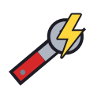 **Monter** (Rigger) | Rola (Impostor Support) | Przerabia prawdziwe stanowiska zadań (do 2 naraz). Gdy załogant trzyma przerobione zadanie otwarte przez chwilę i go nie kończy, pułapka się odpala: Impostorzy dostają alarm i strzałkę do stanowiska, a zadanie zacina się i zamyka. Kto skończy zadanie wcześniej, niczego nie uruchamia. Przerobione stanowiska iskrzą z bliska, więc uważni załoganci mogą je zauważyć. Przeróbki znikają na każdym spotkaniu. Opcjonalnie (domyślnie wyłączone) pułapka zabija też załoganta, na którym się odpaliła. |
| 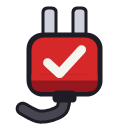 **Wtyczka** (Insider) | Rola (Impostor Concealing) | Impostor, który naprawdę może robić zadania ze swojej listy, więc wszyscy (i Audytor) widzą prawdziwą pracę. Każde ukończone zadanie na stałe trochę skraca jego cooldown zabójstwa (domyślnie o 1 s, do minimum). Domyślnie jego zadania liczą się też do postępu załogi, więc szybsze zabójstwo przybliża też załogę do wygranej na zadania. |
| 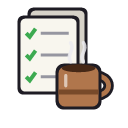 **Pracoholik** (Workaholic) | Rola (Crewmate Support) | Po wykonaniu swoich zadań przejmuje zadania innych członków załogi, po jednym naraz: zawsze niezaczęte zadanie osoby, która ma ich najwięcej do zrobienia (także martwej, jeśli duchy robią zadania), nigdy Snitcha. Właściciel widzi, że ktoś przejął jego zadanie, i nie może go robić. Gdy Pracoholik je skończy, liczy się jako zadanie właściciela. Jeśli Pracoholik zginie, zadanie wraca. Opcje: cooldown, limit przejętych zadań, czy właściciel widzi nick pomocnika. |
|  **Brzuchomówca** (Ventriloquist) | Rola (Impostor Support) | W trakcie rundy podsłuchuje gracza obok siebie (to interakcja). Na najbliższym spotkaniu pisze na czacie głosem tego gracza: wszyscy widzą zwykłą wiadomość od niego, z jego nickiem, kolorem i wyglądem. Gracz widzi tę wiadomość jako swoją i może zaprzeczyć, ale nie wie, kto ją napisał. Z opcją kradzieży głosu (domyślnie zamiast pisania) Brzuchomówca może też przekierować głos tego gracza: trafia on tam, gdzie wskazał Brzuchomówca. Głos działa tylko na jednym spotkaniu i nie da się go użyć, gdy jego właściciel nie żyje, jest uciszony przez Szantażystę albo uwięziony bez dostępu do czatu publicznego. Opcje: cooldown podsłuchu, podsłuchy na grę, wiadomości na spotkanie (domyślnie 1), kradzież głosu (wyłączona / zamiast czatu / razem z czatem). |
| 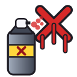 **Wandal** (Vandal) | Rola (Impostor Support) | Przy stanowisku zadania psuje zadanie, które ktoś już skończył: zadanie wraca do właściciela jako niezrobione, od pierwszego kroku, a pasek zadań spada. Domyślnie jedno użycie psuje zadanie jednej losowej osoby, która je zrobiła, a z opcją wszystkim. Właściciel dostaje komunikat i musi zrobić zadanie jeszcze raz (może je przejąć Pracoholik). Tylko zadania żywych graczy, które liczą się do paska zadań, nigdy Snitcha ani zadania zużywające przedmioty na mapie. Audytor liczy każde użycie. Opcje: cooldown, psucia na grę, czyje zadanie psuje jedno użycie, komunikat dla właściciela (z nazwą zadania / bez nazwy / brak). |
| 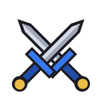 **Rywale** (Rivals) | Modyfikator (Alliance) | Odwrotność Kochanków: dwóch graczy wie, że są rywalami (≠ przy nicku, bez roli). Każdy z nich wygrywa tylko wtedy, gdy drugi nie dożyje końca gry, i to obok zwykłej wygranej swojej drużyny (albo własnej roli): jeśli rywal żyje na koniec gry, przegrywa, nawet gdy jego drużyna wygra. Śmierć rywala nie daje żadnego komunikatu. Opcje: szansa, szansa, że jeden z nich jest zabójcą, obaj mogą być zabójcami, neutralni mogą być Rywalami (tylko załoga = 0% i bez ról neutralnych). |
| 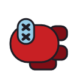 **Symulant** (Possum) | Rola (Impostor Killing) | Udaje trupa: Symulant znika, a w jego miejscu leży jego ciało. Zgłoszenie tego ciała nie zaczyna spotkania: Symulant wstaje, a zgłaszający jest na kilka sekund ogłuszony (nie może się ruszać ani niczego używać). To szansa na zabójstwo, jeśli Symulant ma je gotowe. Symulant wstaje przyciskiem, a sam, gdy skończy się czas albo zacznie się spotkanie. Inne umiejętności używające ciał (Janitor, Undertaker, Sklerotyk...) nie widzą fałszywego ciała. Opcje: cooldown, maks. czas udawania, użycia na grę, czas ogłuszenia. |
| 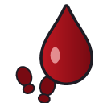 **Krwawiący** (Bleeder) | Modyfikator (załoga) | Po śmierci Krwawiącego jego zabójca przez chwilę zostawia krwawe ślady stóp. Widzą je wszyscy, bez koloru zabójcy. Zabójstwa pośrednie nie zostawiają śladu, a spotkanie go zmywa. Opcje: czas krwawienia, czas widoczności śladu, went kończy ślad, komunikat dla zabójcy. |
|  **Daltonista** (Colorblind) | Modyfikator (uniwersalny) | Dla Daltonisty gracze dalej niż kilka kroków wyglądają jak w kamuflażu (szarzy, bez nicku i domyślnie bez kosmetyków), a z bliska normalnie. Zmienia się tylko jego widok, spotkania wyglądają normalnie. Opcje: zasięg rozpoznawania, ukrywanie kosmetyków. |
| 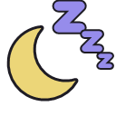 **Lunatyk** (Sleepwalker) | Modyfikator (uniwersalny) | Po dłuższym staniu w miejscu (domyślnie 20 s) Lunatyk zaczyna sam chodzić, wolniej, w losowym kierunku, który zmienia się co jakiś czas i przy ścianach. Każdy ruch go budzi. Robienie zadania, went i spotkanie nie liczą się jako stanie. Opcje: czas stania, prędkość lunatykowania, czas lunatykowania. |
| 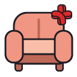 **Wygodniś** (Comfy) | Rola (Crewmate Support) | Denerwuje się, gdy zadanie nie idzie po jego myśli. Zamknięcie własnego zadania, zanim cokolwiek się w nim zrobi, blokuje to zadanie na jakiś czas i, jeśli foch jest gotowy, włącza go: przez kilka sekund zabójstwa i umiejętności na Wygodnisiu się nie udają (jak przy barierze Kleryka), ale nie może robić zadań ani zgłaszać ciał. Póki zadanie jest zablokowane, Wygodniś może je zrzucić na gracza obok (to interakcja, domyślnie 2 razy na grę) i widzi, czy zostało zrobione. Niezrobione zadanie wraca na początku najbliższego spotkania, a impostor go nie zrobi, więc zrzucenie jest też testem. Każda liczba i zasada jest opcją w lobby: czas blokady, czas i cooldown focha, przed czym chroni i co blokuje, liczba i cooldown zrzuceń, czy zadanie wraca, czy odbiorca widzi nick. |
| 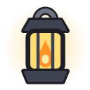 **Latarnik** (Lighthouse Keeper) | Rola (Crewmate Support) | Stawia latarnie na mapie (domyślnie 3 na grę), widoczne dla wszystkich. W trakcie sabotażu świateł każdy gracz w promieniu latarni widzi tak, jakby światła działały, jak z modyfikatorem Torch. Latarnie stoją do końca gry. Opcje: cooldown, liczba latarni na grę, promień światła, ściany zatrzymują światło, wszyscy widzą latarnie, latarnie gasną po śmierci Latarnika. |
| 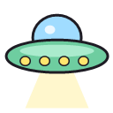 **Ekspert** (Expert) | Rola (Crewmate Investigative) | Bada gracza obok i poznaje jego dokładną rolę, widoczną potem przy jego nicku. Z pewną szansą (domyślnie 30%) wynik jest zmyślony, czyli to inna rola, a Ekspert nigdy nie wie, które wyniki są błędne. Domyślnie każdego gracza można zbadać tylko raz. Opcje: cooldown, liczba ekspertyz na grę, szansa na błędny wynik i jej wzrost z każdą ekspertyzą, co pokazuje błędny wynik (rolę z tej gry / dowolną rolę / rolę innej frakcji), ponowna ekspertyza tego samego gracza. |
| 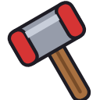 **Moderator** | Rola (Impostor Support) | Banuje gracza obok na jedną rzecz do najbliższego spotkania (albo na określony czas): zgłaszanie ciał, przycisk awaryjny, zadania, wchodzenie do wentów, kamery/admin/vitals (także przenośne), umiejętności (razem z zabijaniem i sabotażem) albo głos na najbliższym spotkaniu (nie liczy się). Rodzaj jest losowany spośród włączonych albo (opcja) wybierany drugim przyciskiem. Naprawa sabotażu, drzwi i drabiny nigdy nie są blokowane. Oczyszczenie Clerica zdejmuje bany. Opcje: cooldown, liczba banów na grę i na rundę, czas bana, każdy rodzaj bana osobno, wybór rodzaju przez Moderatora, komunikat dla zbanowanego. |
| 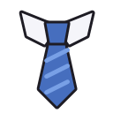 **Prezes** (Chairman) | Rola (Crewmate Support) | Każe graczowi obok skończyć dowolne zadanie w krótkim czasie (domyślnie 30 s). Wykonane zlecenie kończy jedno zadanie Prezesa, a głos gracza na najbliższym spotkaniu liczy się podwójnie; niewykonane oznacza, że jego głos się nie liczy. Impostorzy nie mogą robić zadań, więc zlecenie jest też testem. Wykonane zlecenia dają awanse: Dyrektor (raz na grę spotkanie z dowolnego miejsca), Prezes (widzi, kto na kogo głosował), Król (podwójny głos). Opcje: cooldown, czas, liczba zleceń, darmowe zadanie, premia, nagana, gracz widzi nick, publiczne awanse, każdy tytuł i jego próg. |
|  **Złota Rączka** (Handyman) | Rola (Crewmate Support) | Na początku każdej rundy losuje etat z umiejętnością na tę rundę (domyślnie jedno użycie): Serwis (naprawa sabotażu z dowolnego miejsca), Pizzeria (sprint), Magazyn (admin z dowolnego miejsca) albo Stream (kamery z dowolnego miejsca; nie wypada na mapach bez kamer). Opcje: użycia na rundę, cooldown, ten sam etat dwa razy z rzędu, każdy etat osobno z jego czasem (opóźnienie naprawy, czas i prędkość sprintu, czas admina i ruch z nim, czas kamer). |
| 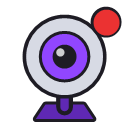 **Streamer** | Modyfikator (uniwersalny) | Widzi „NA ŻYWO: N widzów”, kiedy ktoś ogląda obraz z kamery, na którym jest (kamery mapy, kamery Sentry, przenośne kamery Operative i Złotej Rączki, podgląd Snajpera; z opcją mapa admina), bez nicków. „Wyłączam streama” ukrywa go na kilka sekund przed kamerami. Opcje: admin się liczy, liczba widzów, przycisk „Wyłączam streama”, jego czas i użycia na rundę. |
|  **Snajper** (Stream Sniper) | Rola (Impostor Support) | Przez kilka sekund (domyślnie 8 s) ogląda w okienku w rogu ekranu widok wokół wybranego żywego gracza, przez ściany i ciemność. W tym czasie rusza się normalnie. Oglądanemu Streamerowi przybywa widz. Opcje: cooldown, czas, liczba podglądów na grę, rozmiar widoku, kogo można oglądać (każdego z listy / tylko gracza oznaczonego wcześniej obok siebie), cooldown oznaczenia, spotkanie zdejmuje oznaczenie, oglądany gracz wie. |
| 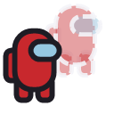 **Mitoman** (Fabulist) | Rola (Impostor Concealing) | Zostawia przy konsoli zadania swoją kopię jako alibi (domyślnie 20 s). Widzą ją wszyscy, także na kamerach, a prawdziwy Mitoman w tym czasie odchodzi. Kopia znika, gdy ktoś do niej podejdzie, przy spotkaniu albo gdy Mitoman zginie; nie da się jej zabić ani zgłosić. Mapa admina pokazuje prawdziwego Mitomana. Opcje: cooldown, czas, liczba alibi na grę, dystans, który psuje alibi, tylko przy konsoli zadania, admin liczy kopię. |
| 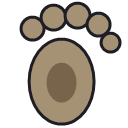 **Kryptyda** (Cryptid) | Rola (Crewmate Afterlife) | Crewmate może nią zostać zaraz po śmierci. „Pojawienie się” pokazuje ducha żywym na kilka sekund jako rozmytą szarą postać bez nicku (także na kamerach). Znika, gdy żywy gracz podejdzie; impostor przepłasza ją na dobre (opcja). Tak duch wskazuje ciało, zabójcę albo pokój bez mówienia. Opcje: cooldown, czas, liczba pojawień na grę, dystans, przy którym znika, impostor przepłasza. |
| 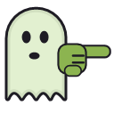 **Krętacz** (Blame Shifter) | Rola (Neutral Afterlife) | Martwy neutral może nim zostać po spotkaniu. Duch obwinia żywego gracza za swoją śmierć (nie swojego zabójcę) i kilka razy na grę, będąc blisko, go opętuje: przez kilka sekund gracz idzie za duchem i nie może nic innego zrobić (widzi błysk, opcja). Wygrywa, gdy obwiniony zostanie wyrzucony (opcja: zbierze dość głosów), razem ze zwycięzcami (opcja: kończy grę). Opcje: cooldown, czas, liczba opętań, zasięg, komunikat dla opętanego, tryb wygranej, potrzebne głosy, wygrana kończy grę. |

Oprócz tego: przycisk „Ustawienia” w trybie Freeplay (zmiana ustawień lobby bez wychodzenia z ćwiczeń), wyszukiwarka
(z przełącznikiem „AmonRa”, który pokazuje tylko role i modyfikatory w klimacie AmonRa) i ikony modyfikatorów w
ustawieniach lobby, automatyczne aktualizacje, pełna paczka instalacyjna i własne logo na
ekranie startowym i w menu głównym.

# Wersje

| Among Us | AmonRa Edition | Bazuje na Town of Us: Mira | Pobierz |
|:--|:--|:--|:--|
| 2026.9.29 | 1.7.9-are.7 | 1.7.9 (`dev`) | [Pobierz](https://github.com/michalekjarmark/TOU-Mira-ARE/releases/tag/v1.7.9-are.7) |
| 2026.9.29 | 1.7.9-are.6 | 1.7.9 (`dev`) | [Pobierz](https://github.com/michalekjarmark/TOU-Mira-ARE/releases/tag/v1.7.9-are.6) |
| 2026.9.29 | 1.7.9-are.5 | 1.7.9 (`dev`) | [Pobierz](https://github.com/michalekjarmark/TOU-Mira-ARE/releases/tag/v1.7.9-are.5) |
| 2026.9.29 | 1.7.9-are.4 | 1.7.9 (`dev`) | [Pobierz](https://github.com/michalekjarmark/TOU-Mira-ARE/releases/tag/v1.7.9-are.4) |
| 2026.9.29 | 1.7.9-are.3 | 1.7.9 (`dev`) | [Pobierz](https://github.com/michalekjarmark/TOU-Mira-ARE/releases/tag/v1.7.9-are.3) |
| 2026.9.29 | 1.7.9-are.2 | 1.7.9 (`dev`) | [Pobierz](https://github.com/michalekjarmark/TOU-Mira-ARE/releases/tag/v1.7.9-are.2) |
| 2026.9.29 | 1.7.9-are.1 | 1.7.9 (`dev`) | [Pobierz](https://github.com/michalekjarmark/TOU-Mira-ARE/releases/tag/v1.7.9-are.1) |

# Problemy

- **Gra uruchamia się bez moda** (brak napisu w menu): w folderze gry zmień nazwę pliku `version.dll` na `winhttp.dll`.
- **Gra zamyka się przy pierwszym uruchomieniu:** sprawdź, czy w folderze gry nie ma jednocześnie `winhttp.dll`
  i `version.dll` (np. po innym modzie). Zostaw tylko `version.dll`.
- **Wyłączenie moda:** usuń (albo zmień nazwę) `version.dll` w folderze gry.
- **Odinstalowanie:** usuń foldery `BepInEx`, `dotnet`, `CorsacCosmetics` i plik `version.dll`, a potem sprawdź
  spójność plików gry w Steam/Epic.
- Błędy z tej edycji zgłaszaj nam, **nie** zespołowi Town of Us. Bardzo pomaga plik `BepInEx/LogOutput.log` z folderu gry.

# Dla twórców

Zobacz [For developers](README.md#for-developers) w wersji angielskiej. Znane pułapki techniczne (po angielsku):
[`CAVEATS.md`](CAVEATS.md).

-----------------------

# Role i modyfikatory

Kliknij ikonę, aby otworzyć jej stronę na wiki Town of Us: Mira (po angielsku). Nasze dodatki prowadzą zamiast tego do
[opisu](#dodatki-amonra-edition): **AmonRa** (wózek, modyfikatory uniwersalne), **Hazardzista** (żeton, Neutral Evil),
**Audytor** (podkładka, Crewmate Investigative), **Monter** (klucz, Impostor Support), **Wtyczka** (wtyczka,
Impostor Concealing), **Pracoholik** (kubek kawy, Crewmate Support), **Brzuchomówca** (dymek na sznurkach,
Impostor Support), **Wandal** (puszka ze sprayem, Impostor Support), **Rywale** (skrzyżowane miecze, modyfikatory
Alliance), **Symulant** (leżący załogant, Impostor Killing), **Krwawiący** (kropla krwi, modyfikatory załogi),
**Daltonista** (oko) i **Lunatyk** (księżyc, oba w modyfikatorach uniwersalnych), **Wygodniś** (fotel) i **Latarnik**
(latarnia, obaj w Crewmate Support), **Ekspert** (latający spodek, Crewmate Investigative), **Moderator** (młotek do
banów, Impostor Support), **Prezes** (krawat, Crewmate Support), **Złota Rączka** (skrzynka z narzędziami, Crewmate Support),
**Streamer** (kamerka internetowa, modyfikatory uniwersalne), **Snajper** (ekran z celownikiem, Impostor Support),
**Mitoman** (załogant z przezroczystą kopią, Impostor Concealing), **Kryptyda** (wielki ślad stopy, Crewmate
Afterlife) i **Krętacz** (duch wskazujący palcem, Neutral Afterlife). Kluczowe różnice Town of Us: Mira,
obsługiwane języki i kompatybilność z innymi modami są w [wersji angielskiej](README.md#town-of-us-mira).

  
  
  
  
  
  
  
  
  
  
  
  
  
  
  
  
  
  
  
  
  
  
  
  
  
  
  
  
  
  
  
  
  
  
  
  
  
  
  
  
  
  
  
  
  
  
  
  
  
  
  
  
  
  
  
  
  
  
  
  
  
  
  
  
  
  
  
  
  
  
  
  
  
  
  
  
  
  
  
  
  
  
  
  
  

  
  
  
  
  
  
  
  
  
  
  
  
  
  
  
  
  
  
  
  
  
  
  
  
  

  
  
  
  
  
  
  
  
  
  
  
  
  
  
  
  
  
  
  
  
  
  
  
  
  
  
  
  
  
  
  
  
  
  
  
  
  
  
  
  
  
  
  
  
  
  
  
  
  
  

-----------------------

# Podziękowania

AmonRa Edition stoi na barkach **[Town of Us: Mira](https://github.com/AU-Avengers/TOU-Mira)** od
**Among Us Avengers** (Atony, AlchlcSystm, angxlwtf, MyDragonBreath, Nix, Satire, xerminator, XtraCube, whichtwix, Zeo)
oraz wszystkich osób, które przyczyniły się do tego moda. Pełna lista podziękowań:
[Contributions & Credits](README.md#contributions--credits).

# Licencja

Oprogramowanie jest rozpowszechniane na licencji GNU GPLv3. BepInEx jest rozpowszechniany na licencji LGPL-2.1.
Pełna treść: [LICENSE.txt](LICENSE.txt). Mod nie jest powiązany z Among Us ani Innersloth LLC, a jego zawartość
nie jest wspierana ani sponsorowana przez Innersloth LLC. Część materiałów jest własnością Innersloth LLC.
© Innersloth LLC.
