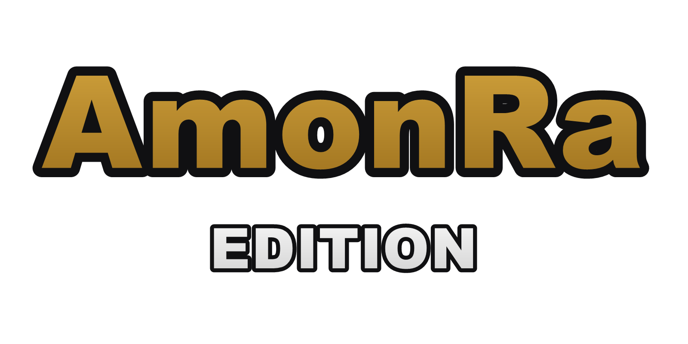
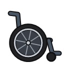
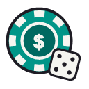
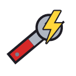

  
  <h1>Town of Us: Mira - AmonRa Edition</h1>
  
  
  
  
<a href="README.md">English</a> | <b>Polski</b>

> [!NOTE]
> To tłumaczenie [README.md](README.md). W razie różnic obowiązuje wersja angielska.

> [!NOTE]
> AmonRa Edition to mała, prywatna edycja moda [Town of Us: Mira](https://github.com/AU-Avengers/TOU-Mira) od AU Avengers,
> robiona do grania ze znajomymi. **Nie** jest powiązana z zespołem Town of Us ani przez niego wspierana, więc błędów
> z tej edycji nie zgłaszaj im. Szukasz oryginalnego moda? Zajrzyj do [oryginalnego repozytorium](https://github.com/AU-Avengers/TOU-Mira).

Mod do [Among Us](https://store.steampowered.com/app/945360/Among_Us) oparty na Town of Salem. AmonRa Edition zawiera
wszystko, co ma Town of Us: Mira, plus nasze własne role, modyfikatory i mechaniki. Aktualizuje się sam, więc po
pierwszej instalacji nic więcej nie trzeba robić.

-----------------------

# Spis treści

- [**Instalacja**](#instalacja)
- [**Aktualizacje**](#aktualizacje)
- [**Dodatki AmonRa Edition**](#dodatki-amonra-edition)
- [**Wersje**](#wersje)
- [**Lista zmian**](CHANGELOG.md)
- [**Problemy**](#problemy)
- [**Dla twórców**](#dla-twórców)
- [**Role i modyfikatory**](#role-i-modyfikatory)
- [**Podziękowania i licencja**](#podziękowania)

-----------------------

# Instalacja

Dla **Steam, Epic Games i Microsoft Store** (Windows, 64-bit).

1. Zaktualizuj Among Us do wersji podanej w tabeli [Wersje](#wersje).
2. Pobierz plik `TOU-Mira-ARE-...-x64-Steam-Epic.zip` z [najnowszego wydania](https://github.com/michalekjarmark/TOU-Mira-ARE/releases/latest)
   i rozpakuj go.
3. Otwórz folder z grą:
   - **Steam:** Biblioteka → prawy przycisk na „Among Us” → Zarządzaj → Przeglądaj pliki lokalne.
   - **Epic Games:** zwykle `C:\Program Files\Epic Games\AmongUs`.
4. Skopiuj **całą zawartość** rozpakowanego folderu (BepInEx, dotnet, CorsacCosmetics, `version.dll` i resztę)
   do folderu z grą. Jeśli Windows zapyta, wybierz „Zamień pliki”.
5. Uruchom grę normalnie. Pierwsze uruchomienie trwa kilka minut. W menu głównym, w lewym górnym rogu,
   powinien pojawić się napis „Town of Us: Mira - AmonRa Edition”.

Wszyscy gracze w lobby muszą mieć **tę samą wersję** moda.

# Aktualizacje

Mod aktualizuje się sam. Przy starcie gry sprawdza, czy jest nowe wydanie, pobiera je w tle (sprawdzając sumę
kontrolną SHA-256) i pokazuje komunikat. Po zakończeniu pobierania wystarczy ponownie uruchomić grę. Co się zmieniło
w każdej wersji, opisuje [lista zmian](CHANGELOG.md) (z polskim tłumaczeniem przy każdej wersji).

Automatyczne aktualizacje można wyłączyć w pliku `BepInEx/config/auavengers.tou.mira.cfg`
(`[Updater]` → `AutoUpdate = false`).

# Dodatki AmonRa Edition

Wszystko poniżej jest nowe w AmonRa Edition. Wszystkie role i modyfikatory Town of Us: Mira są w sekcji
[Role i modyfikatory](#role-i-modyfikatory).

| | Nazwa | Typ | Opis |
|:-:|:--|:--|:--|
|  | **AmonRa** | Modyfikator (uniwersalny) | Postać jeździ na wózku z obracającym się kołem i dźwiękiem toczenia. Rozpędza się stopniowo i toczy się po puszczeniu klawiszy. Wolno jadąc, skręca szybko, ale przy pełnej prędkości potrzebuje szerokich łuków: płynna jazda zachowuje rozpęd i jest szybsza od innych, a ostre skręty dają poślizg i utratę prędkości. Wenty, drabiny i taski działają normalnie. |
|  | **Hazardzista** (Gambler) | Rola (Neutral Evil) | Na każdym spotkaniu, zanim głosy zostaną ujawnione, potajemnie obstawia, kto zostanie wyrzucony (albo że nikt). Trafny zakład daje punkt, chybiony go zabiera. Zebranie wystarczającej liczby punktów za życia oznacza wygraną. Opcjonalnie wszyscy dostają ostrzeżenie (albo Hazardzista zostaje ujawniony), gdy jest blisko wygranej. |
|  | **Audytor** (Auditor) | Rola (Crewmate Investigative) | Potajemnie audytuje pobliskiego gracza przez jakiś czas: raport na najbliższym spotkaniu pokazuje ukończone zadania, stanowiska, przy których cel stał bez postępu, i jedną zbiorczą liczbę nieprawidłowości (wenty, zabójstwa, zdolności ról, także załogantów). Kolejne audyty zdobywa, robiąc zadania. Raz na grę może pokazać raport wszystkim, ujawniając się. Opcjonalnie cel wie, że jest audytowany, a Audytor może zamrozić jeden głos. |
|  | **Monter** (Rigger) | Rola (Impostor Support) | Przerabia prawdziwe stanowiska zadań (do 2 naraz). Gdy załogant trzyma przerobione zadanie otwarte przez chwilę i go nie kończy, pułapka się odpala: Impostorzy dostają alarm i strzałkę do stanowiska, a zadanie zacina się i zamyka. Kto skończy zadanie wcześniej, niczego nie uruchamia. Przerobione stanowiska iskrzą z bliska, więc uważni załoganci mogą je zauważyć. Przeróbki znikają na każdym spotkaniu. Opcjonalnie (domyślnie wyłączone) pułapka zabija też załoganta, na którym się odpaliła. |
|  | **Wtyczka** (Insider) | Rola (Impostor Concealing) | Impostor, który naprawdę może robić zadania ze swojej listy, więc wszyscy (i Audytor) widzą prawdziwą pracę. Każde ukończone zadanie na stałe trochę skraca jego cooldown zabójstwa (domyślnie o 1 s, do minimum). Domyślnie jego zadania liczą się też do postępu załogi, więc szybsze zabójstwo przybliża też załogę do wygranej na zadania. |

Oprócz tego: przycisk „Ustawienia” w trybie Freeplay (zmiana ustawień lobby bez wychodzenia z ćwiczeń), automatyczne
aktualizacje, pełna paczka instalacyjna i własne logo na ekranie startowym.

# Wersje

| Among Us | AmonRa Edition | Bazuje na Town of Us: Mira | Pobierz |
|:--|:--|:--|:--|
| 2026.9.29 | 1.7.9-are.4 | 1.7.9 (`dev`) | [Pobierz](https://github.com/michalekjarmark/TOU-Mira-ARE/releases/tag/v1.7.9-are.4) |
| 2026.9.29 | 1.7.9-are.3 | 1.7.9 (`dev`) | [Pobierz](https://github.com/michalekjarmark/TOU-Mira-ARE/releases/tag/v1.7.9-are.3) |
| 2026.9.29 | 1.7.9-are.2 | 1.7.9 (`dev`) | [Pobierz](https://github.com/michalekjarmark/TOU-Mira-ARE/releases/tag/v1.7.9-are.2) |
| 2026.9.29 | 1.7.9-are.1 | 1.7.9 (`dev`) | [Pobierz](https://github.com/michalekjarmark/TOU-Mira-ARE/releases/tag/v1.7.9-are.1) |

# Problemy

- **Gra uruchamia się bez moda** (brak napisu w menu): w folderze gry zmień nazwę pliku `version.dll` na `winhttp.dll`.
- **Gra zamyka się przy pierwszym uruchomieniu:** sprawdź, czy w folderze gry nie ma jednocześnie `winhttp.dll`
  i `version.dll` (np. po innym modzie). Zostaw tylko `version.dll`.
- **Wyłączenie moda:** usuń (albo zmień nazwę) `version.dll` w folderze gry.
- **Odinstalowanie:** usuń foldery `BepInEx`, `dotnet`, `CorsacCosmetics` i plik `version.dll`, a potem sprawdź
  spójność plików gry w Steam/Epic.
- Błędy z tej edycji zgłaszaj nam, **nie** zespołowi Town of Us. Bardzo pomaga plik `BepInEx/LogOutput.log` z folderu gry.

# Dla twórców

Zobacz [For developers](README.md#for-developers) w wersji angielskiej. Znane pułapki techniczne (po angielsku):
[`CAVEATS.md`](CAVEATS.md).

-----------------------

# Role i modyfikatory

Kliknij ikonę, aby otworzyć jej stronę na wiki Town of Us: Mira (po angielsku). Nasze dodatki prowadzą zamiast tego do
[opisu](#dodatki-amonra-edition): **AmonRa** (wózek, modyfikatory uniwersalne), **Hazardzista** (żeton, Neutral Evil),
**Audytor** (podkładka, Crewmate Investigative), **Monter** (klucz, Impostor Support) i **Wtyczka** (wtyczka,
Impostor Concealing). Kluczowe różnice Town of Us: Mira,
obsługiwane języki i kompatybilność z innymi modami są w [wersji angielskiej](README.md#town-of-us-mira).

  
  
  
  
  
  
  
  
  
  
  
  
  
  
  
  
  
  
  
  
  
  
  
  
  
  
  
  
  
  
  
  
  
  
  
  
  
  
  
  
  
  
  
  
  
  
  
  
  
  
  
  
  
  
  
  
  
  
  
  
  
  
  
  
  
  
  
  
  
  
  
  

  
  
  
  
  
  
  
  
  
  
  
  
  
  
  
  
  
  
  
  
  
  
  
  

  
  
  
  
  
  
  
  
  
  
  
  
  
  
  
  
  
  
  
  
  
  
  
  
  
  
  
  
  
  
  
  
  
  
  
  
  
  
  
  
  
  
  
  
  

-----------------------

# Podziękowania

AmonRa Edition stoi na barkach **[Town of Us: Mira](https://github.com/AU-Avengers/TOU-Mira)** od
**Among Us Avengers** (Atony, AlchlcSystm, angxlwtf, MyDragonBreath, Nix, Satire, xerminator, XtraCube, whichtwix, Zeo)
oraz wszystkich osób, które przyczyniły się do tego moda. Pełna lista podziękowań:
[Contributions & Credits](README.md#contributions--credits).

# Licencja

Oprogramowanie jest rozpowszechniane na licencji GNU GPLv3. BepInEx jest rozpowszechniany na licencji LGPL-2.1.
Pełna treść: [LICENSE.txt](LICENSE.txt). Mod nie jest powiązany z Among Us ani Innersloth LLC, a jego zawartość
nie jest wspierana ani sponsorowana przez Innersloth LLC. Część materiałów jest własnością Innersloth LLC.
© Innersloth LLC.
